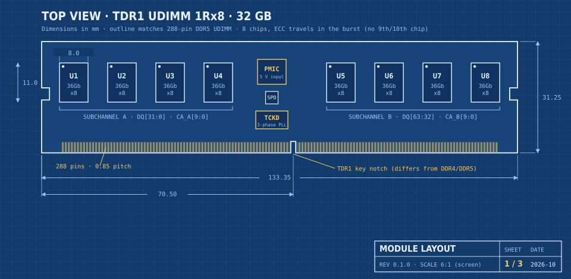
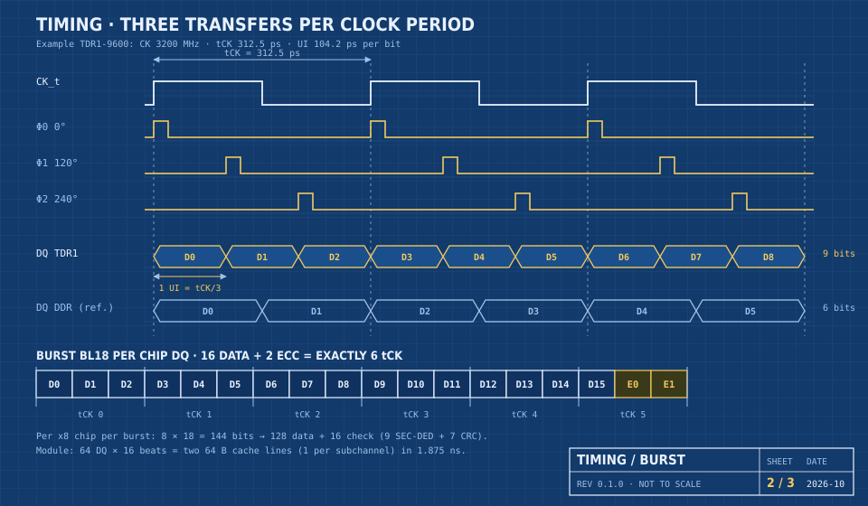
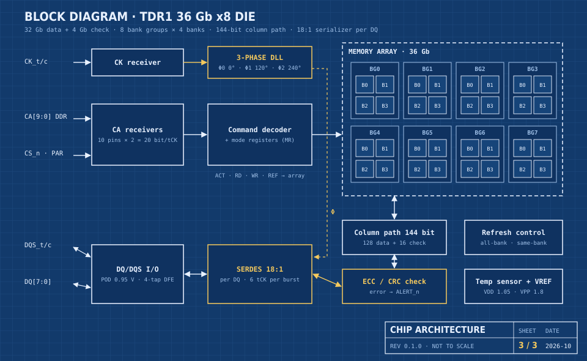

# TDR1-SDRAM

**TDR1 (Triple Data Rate) SDRAM** is a concept memory design that moves **three data transfers per clock period** instead of two. It is drawn up as a JEDEC-style DIMM that could sit alongside DDR5.

> Status: concept, blueprint revision **0.1.0** (2026-10-16). This is not an existing standard. Performance and energy figures come from a calculation model, not from measurements.

## Blueprint sheets

| Sheet | Contents |
| --- | --- |
| [Sheet 1 – Module layout](blueprint/sheet1-en.svg) | Top view of a 288-pin TDR1 UDIMM with dimensions, chip placement, PMIC, SPD hub and 3-phase clock driver (TCKD) |
| [Sheet 2 – Timing and burst](blueprint/sheet2-en.svg) | One clock with three phases (0°/120°/240°), 9 bits per 3 clock periods versus 6 for DDR, and the BL18 burst |
| [Sheet 3 – Chip architecture](blueprint/sheet3-en.svg) | Block diagram of the 36 Gb x8 die: 3-phase DLL, 8 bank groups × 4 banks, 144-bit column path, 18:1 serializer |

The full page with all sheets and tables is [`blueprint/TDR1-blueprint-en.html`](blueprint/TDR1-blueprint-en.html). Download it and open it in a browser.







## Key figures

| Item | TDR1 |
| --- | --- |
| Signalling | One external clock; a DLL in each chip derives three phases. One NRZ bit per data pin per phase. |
| Speed bins | TDR1-7200, 8400, 9600, 10800 MT/s |
| TDR1-9600 | 3200 MHz clock (DDR5 needs 4800 MHz for 9600 MT/s), 76.8 GB/s raw, 68.3 GB/s data per module |
| Burst | BL18 = 16 data + 2 ECC transfers = exactly 6 clock periods |
| ECC | 16 check bits per 128 data bits per chip (9 SEC-DED + 7 CRC), on every module, no extra chips |
| Module | 288-pin DIMM, 133.35 × 31.25 mm, 2 × 32-bit subchannels, key notch at 70.50 mm |
| Voltages | VDD 1.05 V, VDDQ 0.95 V, VPP 1.8 V, 5 V input to the on-module PMIC |
| Energy (model) | ≈14.3 pJ per data bit: 8% below a hypothetical DDR5-9600 and 24% below DDR5-9600 with ECC |

### Limits

- Per pin the signal is no easier than DDR5 at the same MT/s: at 9600 MT/s a bit lasts 104.2 ps either way. The gain is in the lower clock, the lower I/O voltage and the built-in ECC.
- Latency in nanoseconds stays about the same as DDR5 (≈16 ns), because the memory core sets it.
- The three phases must match to within about 2% of a bit time.
- TDR1 needs a new memory controller with a 3-phase PHY.
- The 70.50 mm key position has not been checked against the JEDEC mechanical drawings.

## Tools

The numbers and drawings are generated by Python scripts (standard library only):

```sh
cd tools
python3 tdr1_calc.py        # writes tdr1_numbers.json
python3 make_sheets_en.py   # writes sheet1-en.svg … sheet3-en.svg
python3 make_page_en.py     # writes TDR1-blueprint-en.html
```

The outputs appear in `tools/`; the copies in `blueprint/` are the published versions.

## Roadmap

1. Calculation model and simulation (timing and energy, e.g. DRAMSys or Ramulator 2)
2. Signal integrity (SPICE model of the 3-phase DLL, IBIS-AMI channel simulation)
3. FPGA model (controller RTL, BL18, ECC and phase-balance training at low speed)
4. Bridge module (TDR1 pins outside, a buffer chip or FPGA with standard DDR5 chips behind it)
5. Real TDR1 chip (only feasible with a DRAM manufacturer)

## Sources

- [JEDEC publishes GDDR7: PAM3 and on-die ECC (AnandTech)](https://anandtech.com/show/21287)
- [Cadence on GDDR7 and PAM3 (AnandTech)](https://www.anandtech.com/show/18759/cadence-derlivers-tech-details-on-gddr7-36gbps-pam3-encoding)
- [LPDDR5X standard up to 8533 Mbps (AnandTech)](https://www.anandtech.com/show/16851)
- [TI: DDR5 power rails (VDD, VDDQ, VPP)](https://www.ti.com/tw/lit/pdf/sbaa792)
- [Kingston: clock driver required from DDR5-6400 (CUDIMM)](https://www.kingston.com/en/company/press/article/74306)
